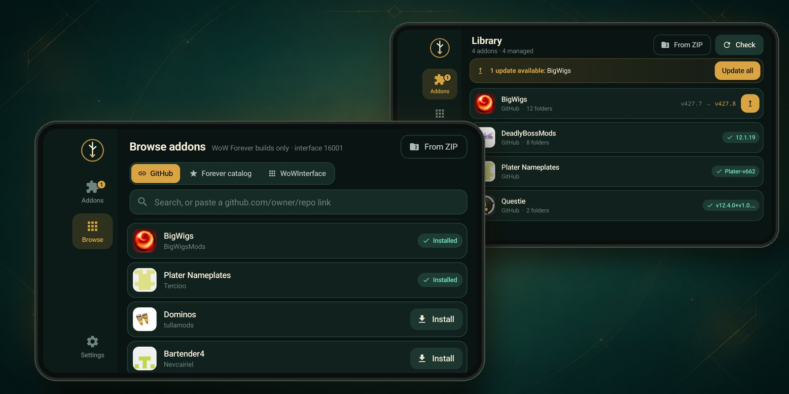
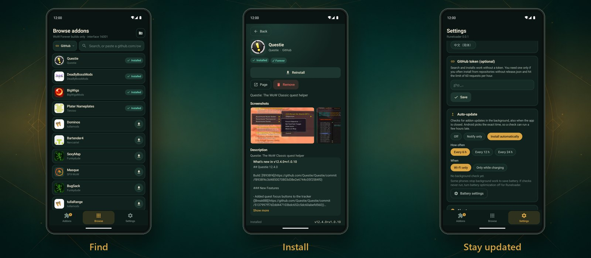
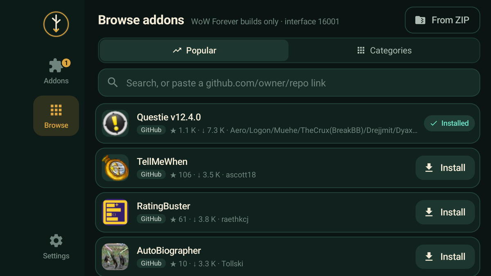
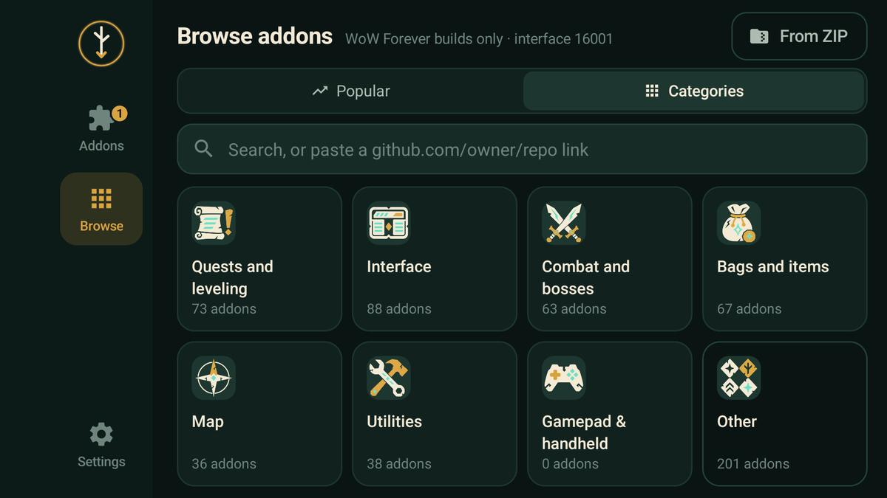
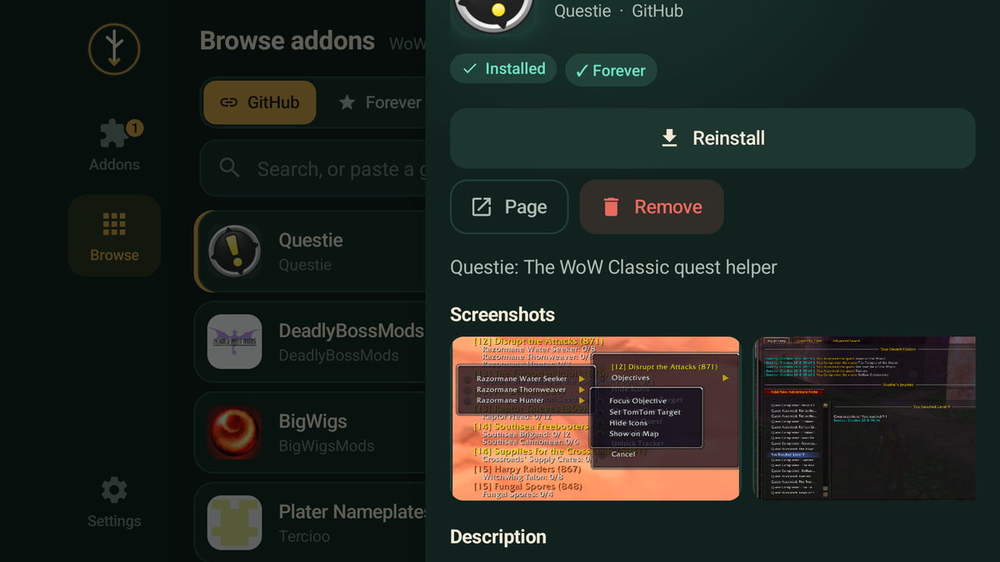
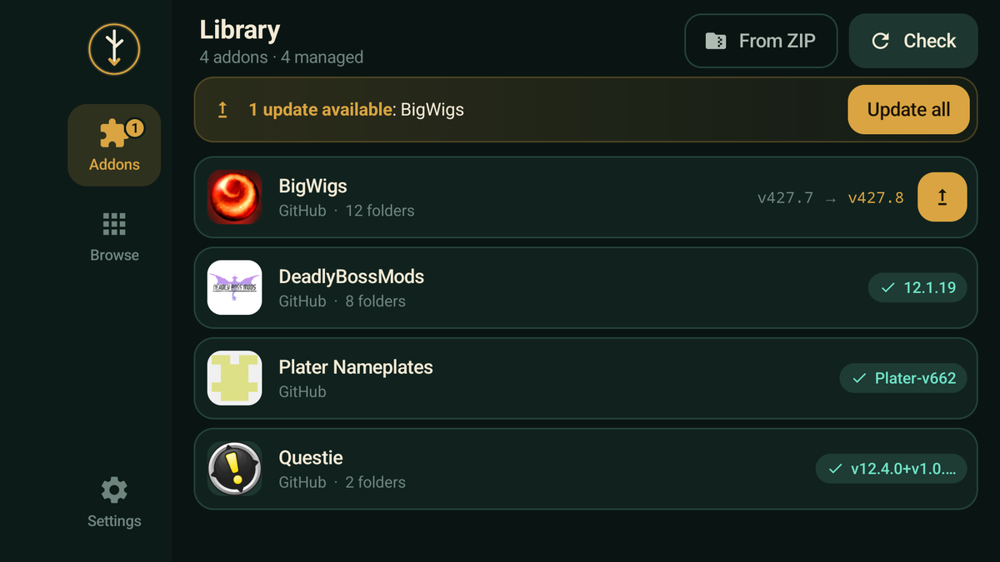
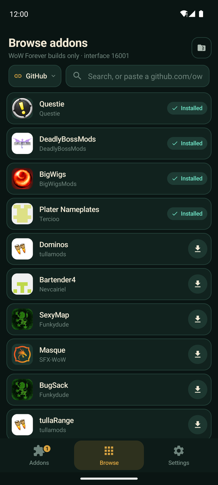
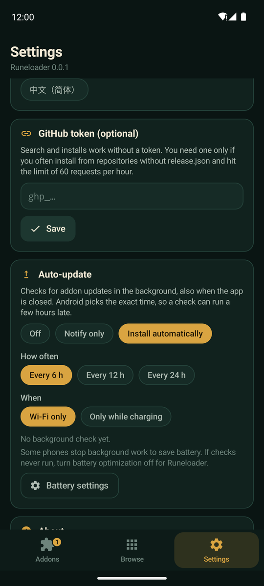

<p align="center">
  <picture>
    <source media="(prefers-color-scheme: dark)" srcset="docs/images/wordmark-dark.png">
    
  </picture>
</p>

<p align="center"><b>Addons for WoW Forever on Android. Find them, install them, keep them updated.</b></p>

<p align="center">
  <a href="../../releases/latest"></a>
  
  
</p>

<p align="center"></p>

---

Installing addons on a phone usually means zip files, file managers and long folder paths. Runeloader does it for you. Search for an addon, tap **Install**, and it goes into the right folder. When a new version comes out, you update it with one tap.

## Features

- **Search in one place.** Runeloader searches addons built for Forever on GitHub and WoWInterface. No accounts, no API keys. The most popular addons come first, or open **Categories** to browse quests, interface, combat and more.
- **Gamepad and handheld addons.** The **Gamepad & handheld** category collects addons made for playing with a controller or on a handheld: extra buttons for back paddles, wheels, chat without a keyboard, Steam Deck presets. With a controller connected, it comes first.
- **See before you install.** Logos, descriptions, screenshots and changelogs for each addon.
- **One-tap install.** The app finds the right folder and the right files for you. If an addon needs another addon, or comes in parts (a core and modules), Runeloader installs what it needs too.
- **Updates.** See which addons are out of date and update them all at once.
- **Updates itself.** When a new Runeloader comes out, the app tells you. Tap **Update**, and Android installs it.
- **Auto-update.** Turn it on in **Settings**, and Runeloader checks for updates in the background, even when the app is closed. It can tell you, or install the updates for you.
- **Your own zips.** Got an addon from somewhere else? Install it from a zip file.
- **Safe.** An addon is replaced only after the new version is fully unpacked, so a broken download never breaks your game.
- **Made for play.** Works in landscape and portrait, by touch or with a gamepad.
- **Your language.** English, German, Spanish, French, Polish, Portuguese, Russian and Chinese.

<p align="center"></p>

<details>
<summary><b>More screenshots</b></summary>

| Browse | Categories | Addon details | Your addons |
| --- | --- | --- | --- |
|  |  |  |  |

| Browse, portrait | Auto-update |
| --- | --- |
|  |  |
</details>

## Install

1. **Download** `runeloader-<version>.apk` from the [latest release](../../releases/latest) on your Android device.
2. **Open** the file. If Android asks, allow installs from your browser or file manager.
3. **Start Runeloader** and allow **All files access**. The app needs it to write into the game folder.
4. **Find your game folder.** Tap **Find automatically**, or pick the game folder or its `AddOns` folder.

That's it. Open **Browse**, find an addon and tap **Install**. Restart the game to load it.

> [!NOTE]
> Runeloader needs Android 10 or newer.

## FAQ

<details>
<summary><b>Android says the app is unsafe or blocks the install</b></summary>

Android shows this for every app that does not come from Google Play. Tap **Settings**, turn on **Allow from this source**, and go back. If Play Protect asks, choose **Install anyway**.
</details>

<details>
<summary><b>I can't find my game folder</b></summary>

Pick the game folder: it has a `.build.info` file or an `Interface` folder inside. You can also pick the `AddOns` folder itself, or any folder you like: addons then go straight into it.
</details>

<details>
<summary><b>An addon I want is not in the search</b></summary>

Paste its GitHub link (for example `github.com/Questie/Questie`) into the search box. Runeloader picks the Forever build from the repository's release. Or download the addon zip yourself and install it with **From ZIP**.
</details>

<details>
<summary><b>An addon doesn't show up in the game</b></summary>

Restart the game after you install or update addons. On the character screen, open **AddOns** and check that the addon is turned on. If it still doesn't load, the addon may not support WoW Forever yet.
</details>

<details>
<summary><b>How do I update Runeloader itself?</b></summary>

Runeloader checks for a new version when you open it. When there is one, tap **Update** and confirm the install. You can also check by hand: **Settings**, **About**, **Check for updates**. The first time, Android asks you to allow installs from Runeloader. Your settings and addon list stay.

You can still download the new APK from the [latest release](../../releases/latest) and install it over the old one.
</details>

## For developers

<details>
<summary><b>Where addons come from</b></summary>

| Source | How it works |
| --- | --- |
| GitHub | Releases with a `forever` flavor in `release.json`, found through the nightly [Runeloader index](https://github.com/Gulliby-development/runeloader-index) or added by link. |
| WoWInterface | The public file API. |
| Zip file | Any zip the user picks on the device. |

The app picks the TOC file the same way the game does: `_Forever`, then `_Camelot`, then `_Mainline`, then the base `.toc`.
</details>

<details>
<summary><b>How an install works</b></summary>

1. The zip is unpacked into a temporary folder. Paths that try to leave it (zip slip) are refused.
2. Addon folders are found by their `.toc` files.
3. Each folder is swapped into `AddOns` in one step, so the old version stays until the new one is ready.

Some addons release each part on its own tag (`Core-v1`, `Wheel-v2`). Runeloader lists the core and each module as separate addons, installs and updates each from the newest release of its own part, and installs the core first when a module needs it.

An optional GitHub token (Settings) is sent only to GitHub hosts, even when a download redirects somewhere else. Installs always take the asset from GitHub directly, because the index can be a day old.
</details>

<details>
<summary><b>Build from source</b></summary>

You need JDK 17 and the Android SDK (`platforms;android-35`, `build-tools;35.0.0`).

```bash
./gradlew assembleRelease               # build/outputs/apk/release/wow-addons.apk
ANDROID_HOME=~/Android/Sdk ./build.sh   # the same app without Gradle: ./wow-addons.apk
```

Without the release key, both builds are signed with a debug key. [AGENTS.md](AGENTS.md) has the code map, the development workflow and the checks to run.
</details>

---

<p align="center">
  <br>
  <sub>Runeloader is a fan project. It is not affiliated with Blizzard Entertainment.</sub>
</p>
